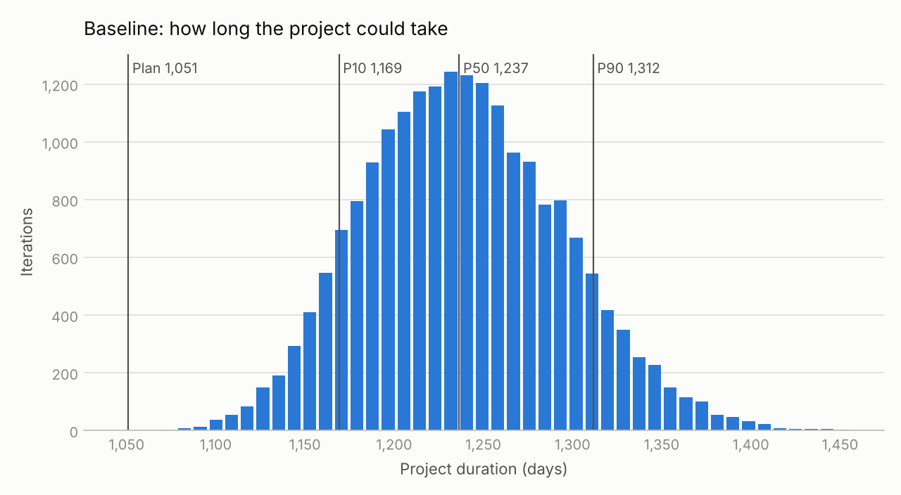
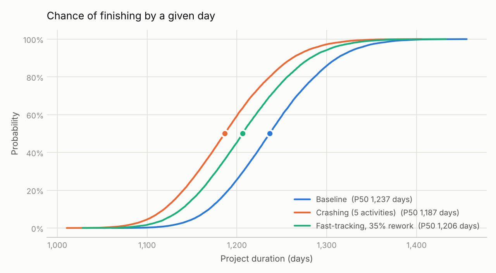
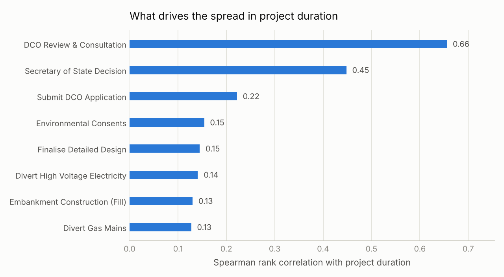

# Schedule risk and recovery on a UK road scheme

A Monte Carlo schedule risk model for a representative UK road enhancement project. It asks a practical question: when a scheme is running late, how much time can crashing or fast-tracking buy back, and at what cost?

This is the Python version of the model I built in Excel for my MSc dissertation at the University of Wolverhampton (2026), *Risk-Informed Schedule Compression Strategies in UK Urban Road Construction Projects* (78%). I rebuilt it so that it can be rerun, checked and extended in a few seconds.

## What it does

- Holds a 50-activity schedule that runs from the DCO application through utility diversions, earthworks, structures and pavement to handover. Each activity has an optimistic, most likely and pessimistic duration, calibrated from National Audit Office and Office of Rail and Road reports.
- Draws every duration from a triangular distribution (Beta-PERT is an option) and runs a critical path forward pass for each of 20,000 iterations.
- Compares six recovery strategies against the baseline.
- Reports P10, P50 and P90 finish times, direct cost, S-curves, and a Spearman rank tornado of the activities that drive the spread.
- Uses the same random draws for every scenario, so differences between scenarios come from the strategy and not from sampling noise.

## Results

20,000 iterations, seed 2026. Durations in days.

| Scenario | P10 | P50 | P90 | Direct cost | Saved at P50 | Premium per day saved |
|---|---:|---:|---:|---:|---:|---:|
| Baseline | 1,169 | 1,237 | 1,312 | £15.77m | – | – |
| Crashing, 5 activities | 1,119 | 1,187 | 1,262 | £17.24m | 50 | £29,400 |
| Crashing, site works only | 1,149 | 1,217 | 1,292 | £16.34m | 20 | £28,500 |
| Fast-tracking, 20% rework | 1,135 | 1,202 | 1,278 | £15.77m | 34 | – |
| Fast-tracking, 35% rework | 1,138 | 1,206 | 1,282 | £15.77m | 30 | – |
| Fast-tracking, 50% rework | 1,142 | 1,210 | 1,287 | £15.77m | 26 | – |
| Crashing + fast-tracking, 35% rework | 1,092 | 1,160 | 1,235 | £17.24m | 77 | £19,124 |

What stands out:

1. **The single-point plan is not a realistic target.** With every activity at its most likely duration the scheme takes 1,051 days. None of the 20,000 runs finished that early, and the median finish was about six months later.
2. **The risk sits before construction starts.** DCO review and consultation (ρ = 0.66) and the Secretary of State decision (ρ = 0.45) drive far more of the spread than any site activity, the strongest of which sit around 0.13 to 0.14.
3. **Crashing buys the most time at a steady price.** Crashing five activities recovers about 50 days for £1.47m, roughly £29,400 a day. Limited to site works, it recovers 20 days for £0.57m.
4. **Fast-tracking costs nothing directly but its gain is less certain.** Overlapping three pairs of activities brings the median forward by 26 to 34 days, and the gain shrinks as rework becomes more likely.
5. **Using both recovers the most:** about 77 days for the same £1.47m premium.

With Beta-PERT durations instead of triangular ones, the baseline median falls to 1,143 days, but the strategies rank in the same order.

<picture>
  <source media="(prefers-color-scheme: dark)" srcset="results/histogram_dark.png">
  
</picture>

<picture>
  <source media="(prefers-color-scheme: dark)" srcset="results/s_curves_dark.png">
  
</picture>

<picture>
  <source media="(prefers-color-scheme: dark)" srcset="results/tornado_dark.png">
  
</picture>

The numbers behind the figures are in `results/summary.csv` and `results/sensitivity.csv`.

## How the model works

1. `data/activities.csv` lists the 50 activities with their predecessors and three-point estimates. Edit it to model a different project. An activity can have several predecessors, separated by `;`.
2. `schedule_risk/sampling.py` draws a duration for every activity in every iteration.
3. `schedule_risk/network.py` schedules all iterations at once. Each activity starts as soon as its predecessors allow (finish-to-start, or start-to-start with an overlap), and the project ends when the last activity finishes.
4. `schedule_risk/scenarios.py` holds the strategies and their cost assumptions: £15,000 per activity-day; up to 25% of an activity's most likely duration can be crashed, at a 50% cost premium; an overlap starts the successor halfway through its predecessor, and rework adds 40% to the successor's duration.
5. `run_model.py` runs every scenario and writes the tables and figures to `results/`.

## Running it

With Python 3.9 or later:

```
pip install -r requirements.txt
python run_model.py
```

Options: `--iterations 50000`, `--seed 7`, `--dist pert`, `--out results/pert`.

Without installing anything, in Google Colab:

```
!git clone https://github.com/Mrmas9/road-schedule-risk.git
%cd road-schedule-risk
!python run_model.py
```

The tests check the scheduling logic: `pip install pytest`, then `pytest`.

## Scope

The schedule is a representative structure for a UK road enhancement scheme rather than a model of one live project, and its inputs come from public audit reports rather than contractor records. The results show how the strategies behave relative to each other; they are not a forecast for a particular scheme. Figures differ a little from the Excel version in the dissertation because this version uses NumPy's samplers, 20,000 iterations and a fixed seed.

## Citation

Shafiq, M. A. (2026). *Risk-Informed Schedule Compression Strategies in UK Urban Road Construction Projects*. MSc dissertation, University of Wolverhampton.

## Licence

MIT. See `LICENSE`.
